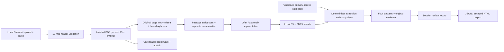

# Architecture

`polisdiff/models.py`: validated Pydantic data contracts. A report includes document
SHA256, catalogue hash/version, applicability/audit dates, retrieval mode actually
used, model revision, timings, findings and timestamped review actions.

`extraction.py` / `extract_worker.py`: page-level original Unicode text, immutable
page-relative character offsets and positional bounding unions. Sentence and
numbered-clause segmentation crosses layout blocks while preserving exact text.
Oversize, encrypted, malformed and excessive-page/passage inputs are rejected.
Raster previews run in a bounded worker and execute no embedded scripts.

`text.py`: independent NFKC/case/whitespace/apostrophe normalization for search.
No transliteration overwrites evidence. Script and domain-vocabulary cues operate
per passage and allow multiple language labels or an undetermined label.
Thousands separators and decimal conventions are parsed deterministically.

`retrieval.py`: multilingual-e5-small on CPU with query/passage prefixes and a
512-token model limit. Queries are authored in all three language variants.
BM25 uses six-character term prefixes, not a learned model. Hybrid mode uses
reciprocal-rank fusion. Offer and appendix each receive a bounded top-8 search
per rule so copied statutes cannot crowd the offer out. The cached model/query
vectors contain no uploaded text. Passage vectors are cleared after analysis.

`engine.py`: scope/event/unit-aware extraction with a deliberately limited
vocabulary. Select a source version using a user-confirmed applicable date;
unknown, future, unsupported or contradictory dates abstain. The audit date is
not a substitute. Examples/conditions, ambiguous units and competing terms abstain.
References and statutory appendices remain evidence of their own context.

`service.py`: one process-wide active analysis with immediate busy feedback;
real extraction/retrieval/evaluation timings. `runtime.py` shares one cached model
between semantic and hybrid web search modes; each retriever has separate passage
state. `app.py` caches these retrievers for
the container/process lifetime; document state and analyst actions stay per session.
Report exports contain original exact quotations, pages and source-version metadata.

No generative LLM supplies legal interpretations or compliance decisions. Network
access is used only to provision dependencies/model and separately research
public sources. The provisioned processing path is fully local. OCR is deliberately
disabled until binary/language resources and independent quality checks exist.

Production extension: authenticated reviewer identity, append-only durable audit
store with retention policy, expert-approved rule versions, process/container
resource isolation, reverse-proxy authentication/rate limiting, more independent
multilingual annotations and monitored date-version maintenance.
